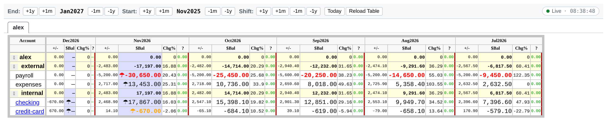
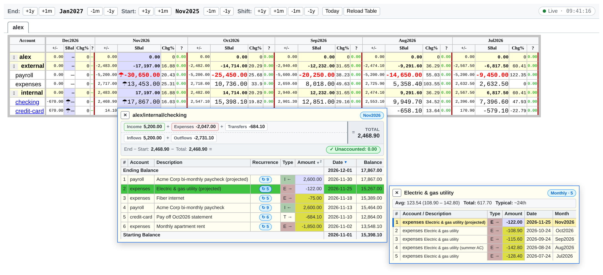

# Tally Sample Data

This directory contains a self-contained, 5-month hypothetical personal ledger (`Jul2026` – `Nov2026`, with projected upcoming entries into `Dec2026`) so you can explore Tally without setting up your own private financial data first.

## Application Preview

### Monthly Spreadsheet View



### Interactive Monthly Statement Drill-Down

Clicking any balance cell opens the itemized statement for that account and month, showing income (`I ←`), expenses (`E →`), internal transfers (`T →`), running balance, confirmed vs. projected entries, and the reconciliation check (`Unaccounted: 0.00`):



## Accounts & Double-Entry Structure

Tally uses double-entry accounting where every transaction is recorded **once** on the source account (`transfers_to:`) and automatically mirrored on the destination account. Accounts are grouped under an owner (`alex`) into **internal** and **external** trees:

```text
sample-data/
├── internal/
│   ├── checking.yaml       # Asset (positive balance): receives paychecks, pays rent/utilities & credit card
│   └── credit-card.yaml    # Liability (negative balance): everyday spending, paid off monthly from checking
└── external/
    ├── payroll.yaml        # Income source (negative cumulative balance): bi-monthly paychecks + Q3 bonus
    └── expenses.yaml       # Spending sink (positive cumulative balance): rent, utilities, groceries, dining
```

### How the Accounting Equations Appear in the Table

- **Net Worth (`internal` row) = Assets (`checking`) + Liabilities (`credit-card`)**:
  - Starts on `2026-07-01` at **$4,250.00** (`$5,000.00` checking − `$750.00` credit card).
  - Grows month-over-month as paychecks exceed spending, reaching **$14,714.00** at the end of `Oct2026` and a projected **$17,197.00** at the end of `Nov2026`.
- **Double-Entry Balance (`alex` root row)**:
  - Because `payroll` opens at `-$4,250.00` (prior net earnings that funded the opening balances), `internal + external = $0.00` in every month, with `+/- = 0.00` and `? = 0.00`.
- **Reconciliation (`?` column)**:
  - For each month `M`, Tally checks `endBalance - startBalance - (inflows + outflows)`. A green `0.00` means every penny is accounted for.
- **Confirmed vs. Projected Entries (`camt` vs. `pamt`)**:
  - `Jul2026` – `Oct2026` are fully confirmed (`camt`).
  - `Nov2026` mixes confirmed transactions with projected (`pamt`) late-month entries (highlighted in blue with `☂`).
  - Credit card balances paid off by a confirmed transfer in the following month appear in black (`Jul2026` – `Oct2026`); `Nov2026`'s `-670.00` balance is covered by a projected payment on `2026-12-10` in `Dec2026`, so Tally highlights it in **orange** (projected-covered).

## Running Tally with This Sample Data

`./tally.sh` uses `sample-data` by default:

```bash
# Development mode (hot-reloading UI at http://localhost:5173)
./tally.sh server --dev

# Production fat JAR mode (http://localhost:8080)
./tally.sh server

# Kotlin/Ktor backend only
./tally.sh server --backend-only
```

To point Tally at your own private YAML directory instead, pass it on the command line (or via `TALLY_FILES`):

```bash
./tally.sh server --dev /path/to/your/data
./tally.sh server --dev --data /path/to/your/data

./tally.sh server /path/to/your/data
./tally.sh server --build --data /path/to/your/data

./tally.sh server --backend-only --data /path/to/your/data
```

You can also try editing any YAML file in `sample-data/` while Tally is running—the server watches the directory and automatically refreshes the browser table and open popups via GraphQL subscriptions.
